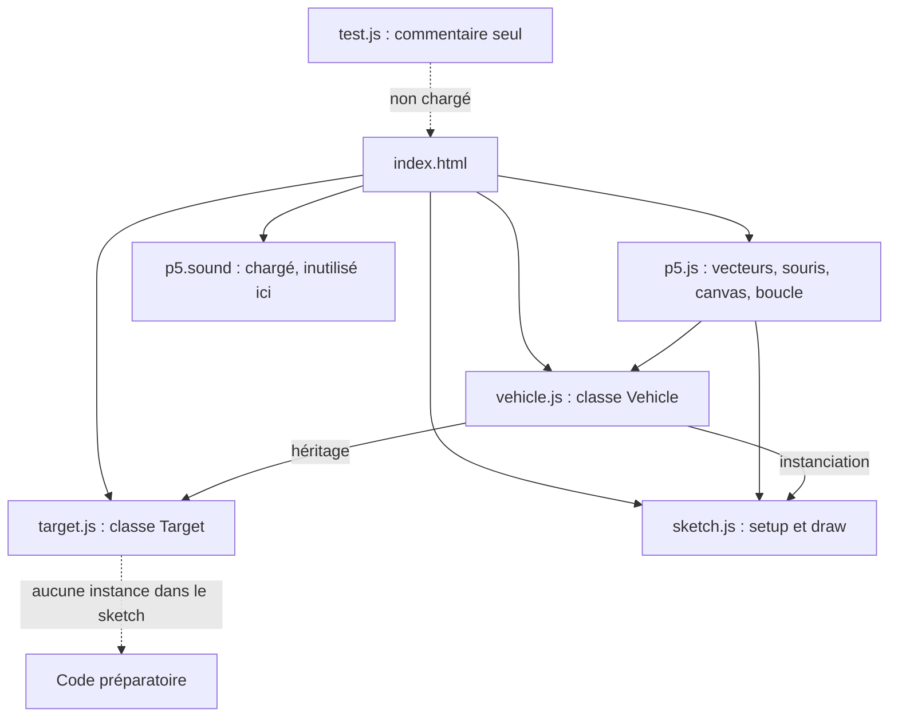
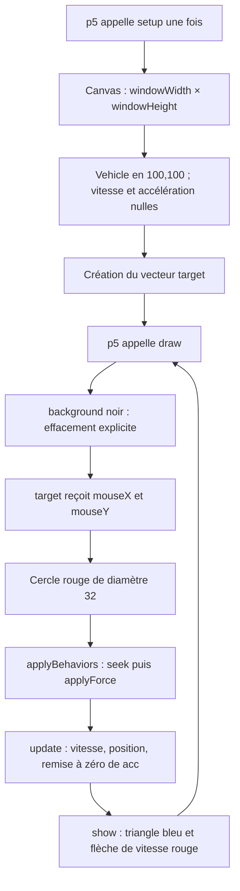
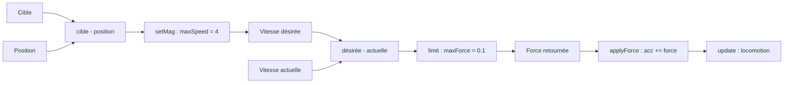
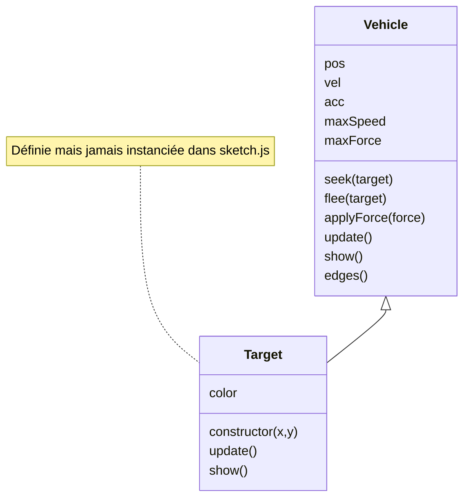

# Analyse de `1-Seek`

**Projet :** `SteeringBehavioursM2IA2_2026_2027` — **Date :** 12 octobre 2026.

## 1. Vue d’ensemble

Cet exemple p5.js montre un véhicule qui se dirige vers la position courante de la souris avec le comportement **seek**. Son intérêt pédagogique est de montrer comment une règle locale de pilotage produit un déplacement progressif : le véhicule ne se téléporte pas sur la cible, il modifie sa vitesse sous l’effet d’une force limitée.

Le cœur de `seek()` est correct pour cet objectif. La démonstration reste cependant un exemple de cours, avec plusieurs éléments inactifs ou préparatoires et quelques limites à expliquer avant de l’étendre.

**Périmètre réel :** un véhicule, une cible représentée par un vecteur, aucun obstacle, aucune collision et aucune anticipation de mouvement. La classe `Target` existe mais n’est pas utilisée. Le véhicule connaît directement la position de la souris : il n’a pas de perception limitée ni de sélection d’objectif élaborée.

Cette analyse porte sur les sources locales, les consignes `AGENTS.md` / `ARCHITECTURE.md`, et l’article de Reynolds fourni dans le dépôt. Elle ne modifie aucun fichier JavaScript.

## 2. Organisation et dépendances

| Fichier | Rôle constaté | État dans l’application |
|---|---|---|
| `index.html`, lignes 11–15 | Charge p5, son extension audio, puis les trois scripts applicatifs | Point d’entrée |
| `sketch.js`, lignes 5–48 | Initialisation, lecture de la souris, orchestration d’une image | Actif |
| `vehicle.js` | État du véhicule, steering, intégration et dessin | Actif ; code fourni protégé |
| `target.js` | Sous-classe mobile, dessin circulaire et variations aléatoires | Définie, jamais instanciée |
| `test.js` | Un commentaire demandant des collisions | Aucun test exécutable ; non chargé par la page |
| `style.css` | Supprime les marges et affiche le canvas en bloc | Actif |
| `jsconfig.json` | Configuration de l’éditeur et des types p5 | Hors exécution navigateur |
| `libraries/p5.min.js` | p5.js **1.7.0**, d’après son en-tête | Dépendance locale utilisée |
| `libraries/p5.sound.min.js` | Extension audio **1.0.1**, d’après son en-tête | Chargée, sans appel audio dans cet exemple |



Les scripts sont classiques, sans modules ES. Leur ordre est significatif : `Vehicle` doit exister avant l’évaluation de `Target extends Vehicle`. L’installation ne requiert pas de build ni de téléchargement de dépendances à l’exécution, puisque les bibliothèques sont embarquées.

## 3. Workflow exécuté

### Démarrage

p5 appelle `setup()` une fois. Le canvas prend les dimensions de la fenêtre au moment du démarrage. Le véhicule est créé en `(100, 100)`, immobile. Une cible vectorielle reçoit une position aléatoire, qui sera remplacée par les coordonnées de la souris dès le premier `draw()`.

### Chaque image



La cible rouge est dessinée avant la mise à jour du véhicule ; le triangle et sa flèche montrent ensuite son nouvel état. Ni `flee()`, ni `edges()`, ni les méthodes de `Target` ne sont appelées par cette boucle.

```mermaid
sequenceDiagram
    participant P as p5
    participant S as sketch.draw
    participant V as Vehicle
    P->>S: nouvelle image
    S->>S: lire souris et dessiner cible
    S->>V: applyBehaviors(target)
    V->>V: force = seek(target)
    V->>V: applyForce(force)
    S->>V: update()
    V->>V: vel += acc ; limiter vel
    V->>V: pos += vel ; acc = 0
    S->>V: show()
    V->>V: dessiner triangle orienté et vecteur vitesse
```

## 4. Calcul du steering et du mouvement

### État et paramètres

| Propriété | Valeur initiale | Signification dans le code actuel |
|---|---:|---|
| `pos` | `(100, 100)` | Position en pixels |
| `vel` | `(0, 0)` | Déplacement par image |
| `acc` | `(0, 0)` | Incrément de vitesse accumulé pour l’image |
| `maxSpeed` | `4` | Norme maximale de la vitesse, en pixels par image |
| `maxForce` | `0.1` | Norme maximale de la force renvoyée par `seek()` |
| `r` | `16` | Paramètre géométrique du triangle, pas un collider |

Avec une masse implicitement égale à 1 et un pas de simulation égal à 1 image :

```text
direction = cible - position
vitesseDésirée = direction ramenée à une norme maxSpeed
force = limiter(vitesseDésirée - vitesseActuelle, maxForce)
accélération += force
vitesseSuivante = limiter(vitesseActuelle + accélération, maxSpeed)
positionSuivante = positionActuelle + vitesseSuivante
accélération = 0
```



`p5.Vector.sub()` crée ici de nouveaux vecteurs : le calcul ne modifie ni la position de la cible ni celle du véhicule. Les opérations mutantes `setMag()` et `limit()` portent sur ces résultats intermédiaires.

**Exemple numérique :** véhicule en `(100,100)`, cible en `(200,100)`, vitesse nulle. La direction vaut `(100,0)`, la vitesse désirée `(4,0)` et la force limitée `(0.1,0)`. Après une mise à jour, la vitesse vaut `(0.1,0)` et la position `(100.1,100)`.

À vitesse maximale, la flèche rouge mesure `4 × 10 = 40` pixels : c’est une visualisation amplifiée de la vitesse, pas une prédiction de position à une durée définie en secondes.

### Lien avec Reynolds

La séparation conceptuelle est lisible :

| Niveau | Traduction dans cet exemple |
|---|---|
| Sélection de l’action | Objectif fixe : rejoindre la position courante de la souris |
| Steering | `seek()` calcule la correction de vitesse ; `applyBehaviors()` choisit ce comportement |
| Locomotion | `applyForce()` accumule les contributions ; `update()` applique les incréments |
| Représentation graphique | `show()` et `drawVelocityVector()` affichent l’état |

L’article fourni expose cette hiérarchie page 2, le modèle de véhicule page 5, seek/flee page 7 et arrival page 9. **Attention à une incohérence dans la copie du PDF :** la formule imprimée de seek page 7 utilise `position - target`, alors que le texte et la figure décrivent une direction vers la cible. Le code utilise bien `target - pos`, le sens correct pour seek.

Même si la souris déplace la cible, le véhicule vise uniquement sa position présente. Cela reste du seek réactif, pas du pursue avec anticipation.

## 5. Points forts

1. **Une démonstration courte et lisible.** La boucle `draw()` montre clairement l’enchaînement perception de la cible → force → mise à jour → dessin. Un étudiant peut suivre le chemin d’exécution sans infrastructure supplémentaire.
2. **Le calcul principal est cohérent.** La soustraction de la vitesse actuelle permet une correction progressive, avec une force et une vitesse bornées. Le mouvement conserve son inertie au lieu d’imposer directement la position.
3. **Le steering retourne une force.** `seek()` peut être réutilisé par d’autres contrôleurs ; il ne déplace pas directement le véhicule. `applyForce()` permet déjà l’accumulation de plusieurs contributions.
4. **La locomotion est centralisée.** L’accélération est remise à zéro après chaque pas, ce qui évite qu’une force appliquée une fois s’accumule indéfiniment entre les images.
5. **Le rendu aide à comprendre le mouvement.** Orientation du triangle selon `vel.heading()`, flèche de vitesse visible et sauvegarde/restauration du contexte graphique avec `push()` / `pop()`.
6. **Une base d’extension existe.** `Target extends Vehicle` illustre la réutilisation de la locomotion, et les TODO annoncent une future collection de véhicules. Cette extension n’est pas encore activée.
7. **Les fichiers sont autonomes et les dépendances locales.** Cela facilite la distribution en cours et réduit la dépendance au réseau.

## 6. Points faibles et risques

### A. Limites de la démonstration active

| Point | Localisation | Conséquence | Importance |
|---|---|---|---|
| `vehicle` n’est pas déclaré avec `let`, `const` ou `var` | `sketch.js:10` | Création d’une propriété globale implicite en script non strict ; erreur en mode strict ou lors d’une migration en module | Élevée pour la maintenabilité |
| Aucun pas de temps explicite | `vehicle.js:64–76` | Une seconde à 30 images/s produit moins de pas qu’à 60 images/s ; mouvement et réactivité dépendent de la machine | Moyenne dans une démo, élevée pour une simulation reproductible |
| Pas de ralentissement à l’approche | `vehicle.js:30–42` | Le véhicule peut dépasser la cible et revenir. Ce comportement est attendu pour seek ; il ne remplace pas arrival | Choix pédagogique à expliciter |
| Aucun test automatique réel | `test.js:1` et absence de lanceur identifié | Les erreurs de signe, limites et cas particuliers ne sont pas protégés par une suite de tests | Élevée avant extension |
| Pas de redimensionnement du canvas | `sketch.js:7` ; pas de `windowResized()` | Le canvas garde ses dimensions initiales après redimensionnement de la fenêtre | Faible à moyenne |
| `edges()` jamais appelé | `vehicle.js:129–140`, boucle `draw()` | Aucun traitement explicite des sorties du canvas ; le rebouclage existe dans la classe mais n’est pas actif | À décider selon la scène |
| Cible dessinée directement comme vecteur | `sketch.js:18,35–41` | Fonctionne pour cette démo, mais ne respecte pas littéralement la consigne locale selon laquelle toute entité visible doit étendre `Vehicle` | Écart d’architecture, pas panne d’exécution |

À distance exactement nulle, le vecteur direction est nul. Dans la version p5 embarquée, `setMag()` s’appuie sur une normalisation qui conserve le vecteur nul : il ne faut pas annoncer ici une division par zéro certaine. La correction devient un freinage de la vitesse actuelle, limité à `maxForce`. Cela ne constitue pas un ralentissement anticipé avant la cible.

`maxForce` limite la force de **seek**, pas toute force passée à `applyForce()`. Si plusieurs comportements sont ajoutés, chaque force peut respecter sa limite alors que leur somme la dépasse. Une politique de composition et de limitation globale devra être définie.

### B. Défaut dans le comportement `flee()` actuellement inactif

`flee(target)` retourne `-seek(target)` (`vehicle.js:48–50`). Or inverser une correction déjà calculée inverse aussi le terme qui compense la vitesse actuelle :

```text
u = vitesse désirée vers la cible
v = vitesse actuelle

seek, avant limitation : u - v
flee actuel : limiter(v - u, maxForce)
flee attendu : limiter(-u - v, maxForce)
```

Les deux expressions coïncident au repos, mais pas en général lorsque le véhicule se déplace.

**Contre-exemple :** position `(0,0)`, cible `(10,0)`, vitesse actuelle `(0,4)`, `maxSpeed = 4`, `maxForce = 0.1`.

| Calcul | Force approximative |
|---|---|
| `seek()` | `(0.07071, -0.07071)` |
| `flee()` actuel | `(-0.07071, +0.07071)` |
| Fuite avec vitesse désirée opposée | `(-0.07071, -0.07071)` |

La version actuelle pousse dans le sens de la composante verticale existante au lieu de la corriger. Cela n’affecte pas le sketch actuel, qui appelle uniquement seek, mais constitue un défaut important si flee est activé. Le fichier `vehicle.js` étant protégé par les consignes du dépôt, toute correction directe nécessite un accord explicite ; une sous-classe ou un comportement séparé permet une extension sans toucher à cette base.

### C. Classe `Target` : extension préparée, avec des réserves



- `Target.update()` réutilise `super.update()` : bon point pour centraliser le déplacement.
- Le constructeur démarre un `setInterval(..., 1000)` sans conserver son identifiant (`target.js:10–21`). Si des cibles sont créées puis retirées, leurs callbacks continueront à référencer ces instances jusqu’à annulation du timer ou fermeture de la page. Ce risque est **latent**, car aucune cible n’est créée actuellement.
- La vitesse est tirée dans `[1,6)`, alors que `maxSpeed` hérité vaut `4`. Le prochain `super.update()` la limite ; une partie de la plage annoncée ne peut donc pas être maintenue.
- Le timer remplace directement vitesse et accélération ; `update()` change aussi directement l’orientation de la vitesse à chaque image. Ces variations sont valables pour une cible volontairement imprévisible, mais ne constituent pas un steering continu limité par `maxForce`. Elles ne respectent pas le circuit de forces demandé pour de nouveaux comportements.
- La variation angulaire indépendante à chaque image n’implémente pas à elle seule un wander conservant une direction de variation continue.
- Le timer utilise des millisecondes réelles alors que le mouvement avance par images : les deux rythmes évoluent différemment si la cadence baisse ou si l’onglet est suspendu.
- `Target.show()` ne sauvegarde pas le contexte avec `push()` / `pop()`. Son activation rendrait l’ordre de dessin plus sensible aux styles laissés par cette méthode.

### D. Maintenance et précision pédagogique

- `p5.sound` n’est pas utilisé : chargement et poids supplémentaires sans rôle dans cette scène. Son retrait éventuel concerne `index.html`.
- Le chemin de types dans `jsconfig.json:8` est absolu et pointe vers `/Users/mbuffa2/...`. Il dépend d’une installation VS Code particulière ; cet inconvénient concerne l’éditeur, pas l’exécution dans le navigateur.
- Plusieurs commentaires sont décalés du code : canvas annoncé à 800×800 au lieu de la fenêtre (`sketch.js:6`), cercle décrit comme de rayon 32 alors que 32 est son diamètre (`sketch.js:38–41`), changement toutes les 500 ms alors que le timer vaut 1000 ms (`target.js:11,21`).
- Le commentaire indiquant un effacement automatique à chaque `draw()` est trompeur : dans cet exemple, c’est l’appel explicite à `background()` qui efface la scène.
- Les 60 images/s mentionnées sont une cadence visée, pas une garantie. La cadence réelle dépend notamment de la charge et du navigateur.

## 7. Améliorations proposées, par ordre de priorité

| Priorité | Proposition | Périmètre conseillé |
|---|---|---|
| 1 | Déclarer explicitement `vehicle` et corriger les commentaires | `sketch.js` ; commentaires de `target.js` |
| 1 | Ajouter des tests reproductibles de seek et un contre-exemple de flee | Véritable suite dans `1-Seek`, avec commande documentée |
| 1 avant usage de flee | Implémenter une fuite fondée sur une vitesse désirée opposée | Comportement indépendant ou sous-classe ; accord préalable pour modifier `vehicle.js` |
| 2 | Clarifier le statut de la cible : souris, ou véritable instance de `Target` | Choix explicite dans le sketch ; respecter les consignes d’entité |
| 2 | Définir le cycle de vie de `Target` et nettoyer son timer si elle est activée | `target.js` |
| 2 | Définir les règles aux bords et au redimensionnement | Contrôleur du sketch ; ne pas appeler `edges()` sans choisir la topologie souhaitée |
| 3 | Ajouter arrivée, composition de forces et collection de véhicules comme extensions distinctes | Sous-classes/comportements séparés ; réutilisation de la locomotion |
| 3 | Rendre le pas de simulation explicite et mesurer la dépendance à la cadence | Évolution concertée de la locomotion ; ne pas dupliquer `update()` pour contourner la protection |
| 3 | Alléger les dépendances et rendre la configuration de types portable | `index.html` et `jsconfig.json` |

Pour de futurs tests : vérifier une force dirigée vers la cible au repos, la correction d’une vitesse latérale, les bornes de force/vitesse, l’absence de mutation de la cible, la remise à zéro de `acc`, la position exactement confondue avec la cible et la somme de plusieurs forces. Pour `Target`, fixer l’aléatoire et contrôler le timer afin de rendre les résultats reproductibles.

Ces propositions ne sont pas des changements déjà réalisés. En particulier, l’absence d’arrival, de collisions ou de flocking n’est pas un défaut de cet exercice consacré à seek : ce sont des objectifs d’autres exemples ou d’extensions.

## 8. Vérifications et limites de l’analyse

- Lecture des fichiers applicatifs, de la configuration et des consignes du dépôt.
- Vérification de l’ordre de chargement et des chemins d’appel : seul `seek()` pilote le véhicule dans le sketch fourni.
- Consultation du PDF local de Reynolds, notamment pages 2, 5, 7 et 9 ; inspection visuelle de la page 7 pour vérifier le schéma seek/flee et l’incohérence de signe de la formule imprimée.
- Vérification syntaxique réussie de `sketch.js`, `vehicle.js`, `target.js` et `test.js` avec `node --check`, en utilisant le runtime Node fourni par Codex. Cette vérification ne lance ni p5 ni la simulation et ne remplace pas des tests fonctionnels.
- Aucun test automatique exécutable ni lanceur identifié dans `1-Seek` : `test.js` contient seulement un commentaire. Aucun résultat de test comportemental ou de validation dans le navigateur n’est revendiqué.
- Aucun fichier source modifié ; notamment **`vehicle.js` reste inchangé**. Seul ce document est ajouté. Les schémas sont en Mermaid ; un lecteur Markdown compatible est nécessaire pour les afficher graphiquement.

### Références locales

- [Consignes du dépôt](../AGENTS.md) et [architecture](../ARCHITECTURE.md).
- [Entrée HTML](index.html), [sketch](sketch.js), [véhicule](vehicle.js), [cible](target.js), [fichier test](test.js).
- Craig W. Reynolds, *Steering Behaviors for Autonomous Characters*, GDC 1999, [copie PDF fournie](../ARTICLE_CRAIG_REYNOLDS/Steering%20Behaviors%20For%20Autonomous%20Characters.pdf).
